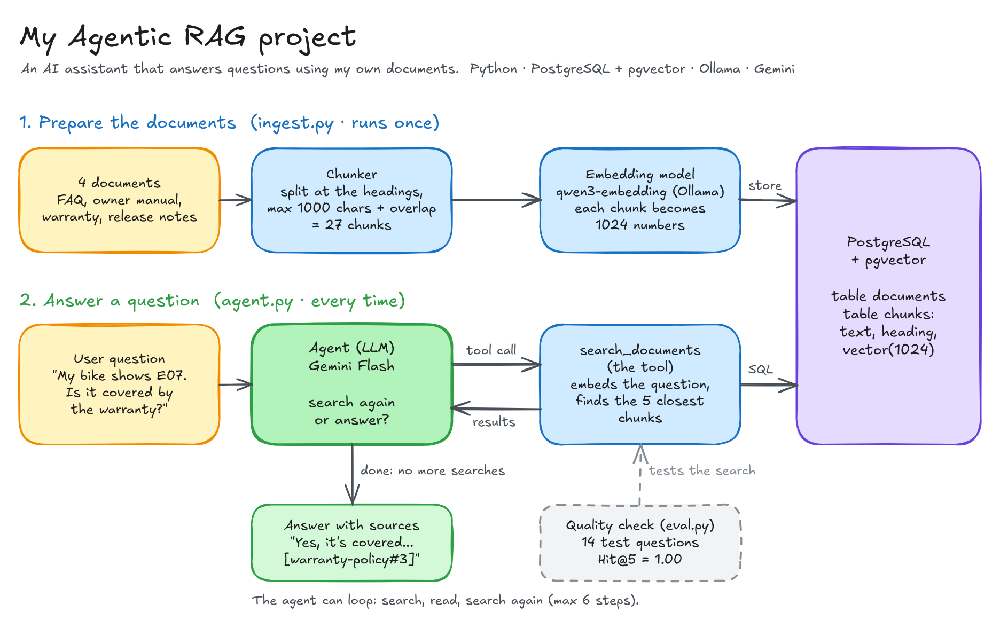

# Agentic RAG project



This is a small AI assistant that answers questions about a company's documents.

First, the documents are cut into small pieces, using their headings. Each piece is turned into 1024 numbers that capture its meaning, and stored in PostgreSQL with pgvector.

When someone asks a question, the AI (Gemini) decides by itself whether it needs to search. If it does, it calls a search tool that finds the 5 pieces closest in meaning to the question. The AI reads them, searches again if something is missing, then answers and shows where each fact comes from. If the answer isn't in the documents, it says so instead of guessing.

To check the quality, I wrote 14 test questions. For all 14, the right piece of text was found in the top 5 results.

## Built with

- Python 3.14 and [uv](https://docs.astral.sh/uv/)
- PostgreSQL 18 + pgvector (in Docker)
- Ollama with `qwen3-embedding:0.6b` for the embeddings
- Gemini Flash (free tier), through the OpenAI-compatible API

## Run it

You need Docker, [Ollama](https://ollama.com) and a free Gemini API key from [Google AI Studio](https://aistudio.google.com/apikey).

```bash
docker compose up -d --wait            # start PostgreSQL + pgvector
ollama pull qwen3-embedding:0.6b       # download the embedding model
```

Create a `.env` file:

```
LLM_API_KEY=your-gemini-key
LLM_BASE_URL=https://generativelanguage.googleapis.com/v1beta/openai/
LLM_MODEL=gemini-3.8-flash
```

Then:

```bash
uv run db.py                                   # create the tables
uv run ingest.py                               # chunk, embed and store the documents
uv run agent.py "What does error E05 mean?"    # ask a question
uv run eval.py                                 # measure the search quality
```
